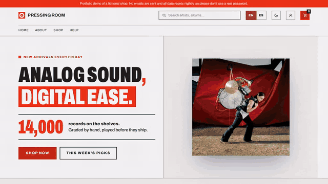
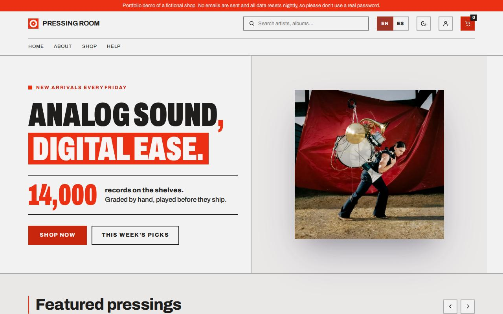
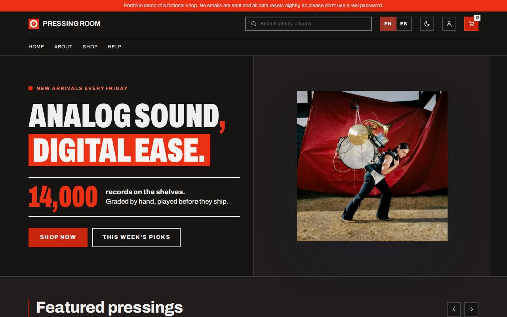
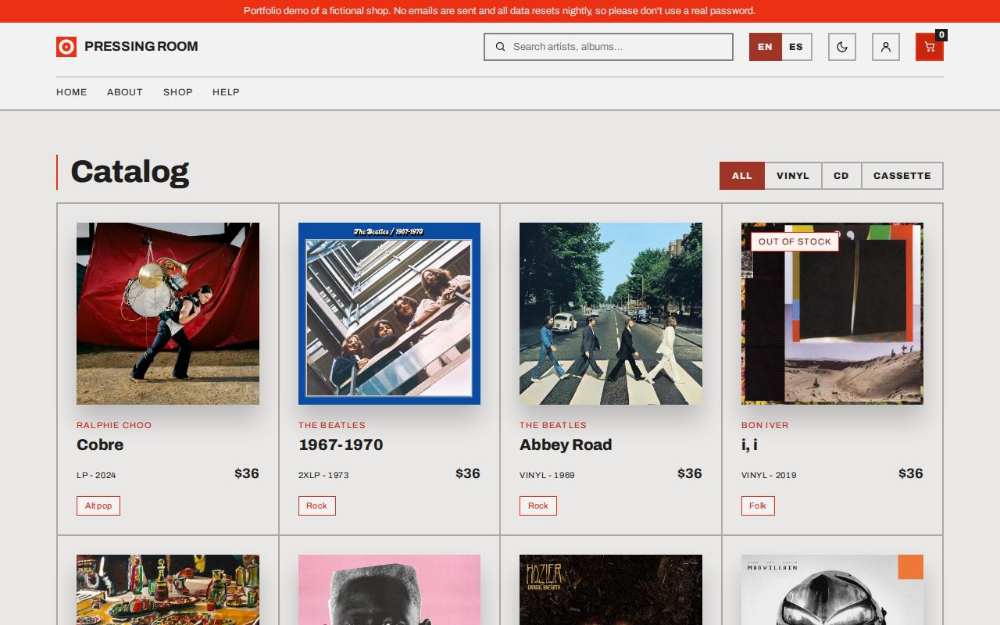
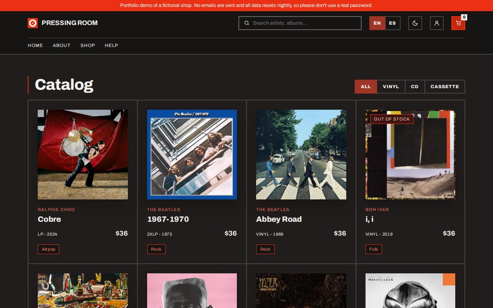
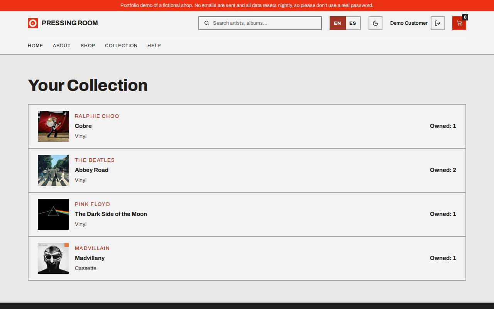
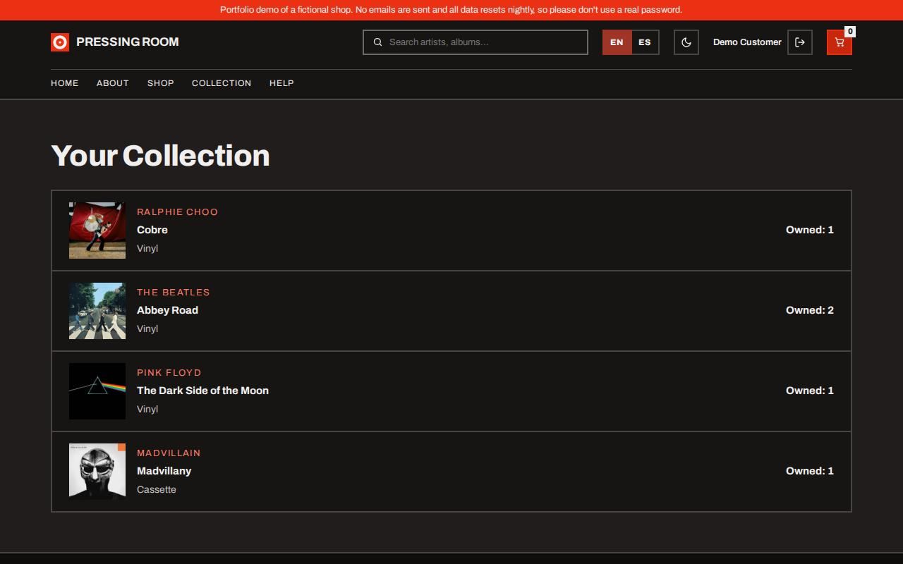
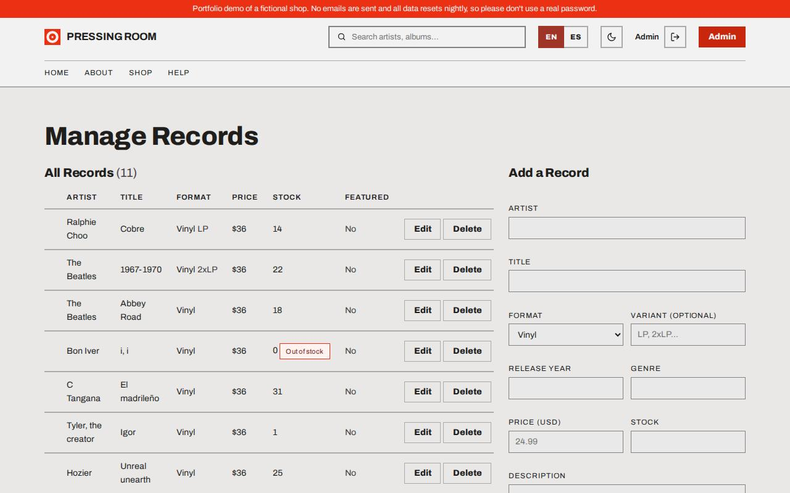
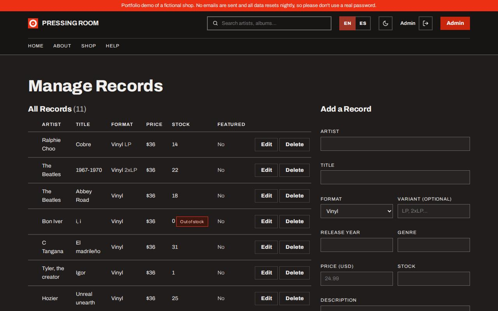

# Pressing Room

[](https://github.com/shezcode/pressing-room/actions/workflows/ci.yml)
[](LICENSE)

**Live demo: [pressingroom.shezcode.com](https://pressingroom.shezcode.com)**: no sign-up needed. Click "Try as Customer" or "Try as Admin" on the login page.

Pressing Room is a record shop built with **Angular 20** (zoneless, signals, standalone components) and a small Node/Express API. Visitors browse and search the Catalog, filter it by Format and fill a Cart. Customers check out and keep a Collection of what they bought. The Admin manages the Catalog, including cover uploads. It ships as one Docker image, is tested end to end with Playwright on every push, and deploys itself when `main` goes green. The shop is fictional and the demo resets its data every night.



## Screenshots

| | Light | Dark |
| --- | --- | --- |
| Landing |  |  |
| Catalog |  |  |
| Collection |  |  |
| Admin |  |  |

## Angular techniques

- **Standalone components** throughout: no NgModules, and `bootstrapApplication` with `appConfig`.
- **Signals** for component and service state (`signal`, `computed`), for example the theme, the Cart and the session.
- **Zoneless change detection** (`provideZonelessChangeDetection`): no zone.js in the bundle.
- **`OnPush`** change detection on the page and feature components.
- **Lazy routes**: every page is a `loadComponent` route, so each one is its own chunk.
- **`@defer`** for content below the fold on the landing page.
- **Functional route guards** (`customerGuard`, `adminGuard`, `notAdminGuard`) and an **HTTP interceptor** that attaches the session token and handles expired sessions.
- **Reactive forms** with validation for sign-in, sign-up, checkout (with dependent country, community and province selects) and the Admin's Record form.
- **i18n** in English and Spanish with ngx-translate, switchable at runtime.
- **Theming**: light and dark Angular Material themes, switched with one body class.
- **Unit tests** with Jasmine and Karma. Services are tested against `HttpTestingController`; components are mostly tested through their rendered templates.
- **Playwright end-to-end tests** of the main journeys (shopping, checkout, admin, language, demo reset), run against the production image in demo mode.

## Architecture

```text
Browser ──> one Node process (production image)
            ├── /              built Angular app (hash routes, e.g. /#/records)
            ├── /api, /auth    Express API (JWT sessions, helmet, rate-limited sign-in)
            ├── /location      country, community and province lookups
            ├── /uploads       Record covers
            └── /api-docs      Swagger UI
            data: JSON files in backend/db/
```

| Folder        | What it is                                                                                         |
| ------------- | -------------------------------------------------------------------------------------------------- |
| `frontend/`   | Angular 20.3 app. `core/` (security, theme, locale), `data/` (one service per resource), `features/` (one folder per page), `common/` (shared components), `layout/`. Playwright tests in `frontend/e2e/`. |
| `backend/`    | Node/Express API with JSON-file storage, a seed script and demo mode.                              |
| `docs/`       | Architecture decision records (`docs/adr/`), the deploy guide and the README images.               |
| `GLOSSARY.md` | Domain vocabulary (Record, Format, Catalog, Cart, Collection…) used in code, API and routes.      |

Each project keeps its own `package.json` and lockfile. There are no npm workspaces, so install and run each one from its own folder.

In demo mode (`DEMO_MODE=true`), every start resets all data to the seed and the frontend shows a demo banner and one-click sign-in. The production container starts fresh each night, so the public demo never keeps visitors' data. Orders copy the Record's details at purchase time, so editing or deleting a Record never rewrites a Customer's history (ADR 0001).

## Run it locally

### Requirements

- Node.js 20.19 or newer (Angular 20 requirement), npm 10+
- Google Chrome or Chromium, for the frontend's Karma specs
- Docker, for the Docker setups and the Playwright tests

### With Docker (development)

```bash
docker compose up          # API on :3000, Angular app on :4200 (add -d to detach)
docker compose logs -f     # follow both servers
docker compose down        # stop (add -v to also drop the node_modules volumes)
```

The first start installs dependencies into named volumes, which takes a few minutes; later starts reinstall only if a `package-lock.json` changed. Source folders are bind-mounted, so edits reload live, and the backend's JSON database in `backend/db/` is the same one you get running it directly. The frontend waits for the API to be healthy. To seed the catalog: `docker compose exec backend npm run seed`.

Docker runs as root, so it leaves empty root-owned `node_modules/` folders (and `frontend/.angular/`) in `backend/` and `frontend/`. Before running `npm install` or `npm start` directly on the host in the same checkout, stop the stack and remove them (`sudo rm -rf backend/node_modules frontend/node_modules frontend/.angular`).

Override the host ports with `BACKEND_PORT` and `FRONTEND_PORT` if the defaults are taken (the backend allows calls from the `FRONTEND_PORT` origin). The frontend calls the API at `apiBaseUrl` in `frontend/src/environments/environment.dev.ts`, so if you move the backend port, change that value to match.

### With Docker (the production image, as deployed)

The root `Dockerfile` builds one image: a single Node process serves the built Angular app at `/` next to the API, `/uploads` and `/api-docs`, all from one origin. It seeds the data at start (with `DEMO_MODE=true`, the full Demo reset) and reports health at `/api/health`.

```bash
docker build -t pressing-room .
docker run -p 8080:3000 -e JWT_SECRET=change-me -e ADMIN_EMAIL=admin@example.com -e ADMIN_PASSWORD=change-me pressing-room
```

Then open http://localhost:8080.

### Without Docker

Backend:

```bash
cd backend
npm install
npm run seed       # first time: creates the Admin and the sample Catalog
npm start          # or: npm run dev   (restarts on change with nodemon)
```

The API listens on http://localhost:3000 (override with `PORT`). `GET /` returns the welcome route and the Swagger docs are at http://localhost:3000/api-docs.

Frontend, in a second terminal:

```bash
cd frontend
npm install        # runs a preinstall dependency-age check first
npm start
```

The app is served at http://localhost:4200 and expects the backend at http://localhost:3000. The API address is `apiBaseUrl` in `frontend/src/environments/`: `npm start` serves the `dev` configuration, which reads `environment.dev.ts`.

### Tests and other scripts

From `frontend/`:

```bash
npm run lint
npm run test:ci            # unit tests: single headless run with coverage
npm run e2e                # Playwright: builds the production image, runs it in demo mode, tests it, removes it
npm run capture:readme     # retakes the README screenshots and GIF the same way (needs ffmpeg)
npm run build_production   # output in frontend/dist/pressing-room/browser
npm run bundle:report      # source-map-explorer over the last build (run `npm run build_pre` first, it keeps source maps)
npm run extract:translations
```

Playwright needs Chromium once: `npx playwright install chromium`. Extra arguments go to Playwright, e.g. `npm run e2e -- --grep Cart`.

Build configurations live in `frontend/angular.json` and pick an environment file from `frontend/src/environments/`: `dev` (the default for `npm start`), `pre` and `production`.

`npm install` in `frontend/` also installs the frontend's husky hooks into this repository's `.git`. They run commitlint on commit messages (Conventional Commits) and `check:deps-age`, `lint` and `test:ci` on push.

See `backend/README.md` for the API's own documentation.

## Server settings

The backend reads these environment variables. None is needed locally.

| Variable | Default | Purpose |
| --- | --- | --- |
| `PORT` | `3000` | Port the API listens on. |
| `NODE_ENV` | unset | Set to `production` on the server. It makes `JWT_SECRET` required, trusts one reverse proxy's `X-Forwarded-For` (so rate limits are per visitor) and enables the `upgrade-insecure-requests` CSP directive. |
| `JWT_SECRET` | development-only fallback | Secret that signs the session tokens. **Required when `NODE_ENV=production`**: without it the server exits at start. Locally a fallback is used and a warning is logged. Use a long random value, e.g. `openssl rand -hex 32`. |
| `ALLOWED_ORIGINS` | `http://localhost:4200` | Comma-separated list of origins allowed to call the API cross-origin, e.g. `https://a.example,https://b.example`. Set it when you serve the frontend on another port. |
| `DEMO_MODE` | unset | Set to `true` to run as the public Demo: every start resets all data to the seed (the Admin, the Demo Customer with two past Orders, the Catalog; no other Customers, Orders or Subscribers) before listening, and `GET /api/demo` answers `{ "enabled": true }` so the frontend shows the demo banner. |
| `DEMO_CUSTOMER_EMAIL`, `DEMO_CUSTOMER_PASSWORD` | `customer@mail.com`, `customer123!` | The Demo Customer's credentials, used in demo mode. **Required with `NODE_ENV=production` and `DEMO_MODE=true`**, as are `ADMIN_EMAIL` and `ADMIN_PASSWORD` (see [Seed data](#seed-data)). |

Every response carries standard security headers (helmet). Sign-in and sign-up share a limit of 20 requests per 15 minutes per IP and answer `429` with a JSON `message` beyond it. JSON and form bodies are limited to 100 kB; cover uploads (multipart) keep their own 5 MB limit.

### Seed data

```bash
cd backend
npm run seed
```

Creates the Admin account (if it does not exist yet) and replaces the catalog with 11 sample Records (run it again at any time to reset the catalog). It also creates any missing data file: the Customer, Order, Record and Subscriber files in `backend/db/` are not tracked in git, so a fresh clone starts empty and the shop shows nothing until you have seeded. The backend still starts without them and treats them as empty. No Customers or Orders are created: sign up from the login page to get a Customer. Cover images live in `backend/uploads/covers/` and are served under `/uploads`.

Which Records are which:

- Newest (hero artwork): Ralphie Choo, _Cobre_
- Featured: Pink Floyd, _The Dark Side of the Moon_, and Harry Styles, _Harry's house_
- **Out of stock** (stock 0): Bon Iver, _i, i_
- **One copy left** (stock 1): Tyler, the creator, _Igor_
- **Cassette**: Madvillain, _Madvillany_
- **CD**: Frank Sinatra, _Nothing but the best_
- Everything else is Vinyl with stock between 12 and 31

### Admin account

The seed creates the shop's single Admin from two environment variables:

```bash
ADMIN_EMAIL=you@example.com ADMIN_PASSWORD='a-strong-password' npm run seed
```

Locally both are optional and fall back to development defaults (see `backend/scripts/seed.js`). With `NODE_ENV=production` the seed refuses to run unless both are set. The Admin is only created once, so changing the variables later does not change an existing Admin: delete it from `backend/db/users.json` and seed again.

The Admin gets an **Admin** link in the header to manage Records (create, edit, restock, feature, delete). The Admin cannot shop: the Cart, checkout and Collection are closed to it. Signup always creates a Customer.

## Deployment and CI

GitHub Actions (`.github/workflows/ci.yml`) runs lint, unit tests, the production build and the Playwright suite on every push and pull request. When both pass on `main`, it pushes the image to GHCR and deploys it.

On the server, `docker-compose.prod.yml` runs the image from GHCR on Nginx Proxy Manager's network without publishing a port. Copy `.env.example` to `.env` and fill it in; it lists every setting. The one-time VPS setup is in [`docs/deploy.md`](docs/deploy.md).

## Lighthouse

<!-- SITE OWNER: run Lighthouse (Chrome DevTools > Lighthouse, desktop and mobile) against https://pressingroom.shezcode.com and replace the TODO cells below with the scores and the date. -->

Measured against the live demo on **TODO: date**:

| | Performance | Accessibility | Best Practices | SEO |
| --- | --- | --- | --- | --- |
| Desktop | TODO | TODO | TODO | TODO |
| Mobile | TODO | TODO | TODO | TODO |

## How it was built

The app was specified before it was built. A glossary (`GLOSSARY.md`) fixes the domain vocabulary, architecture decision records (`docs/adr/`) capture the choices that were hard to reverse, and a written spec was broken into small tickets with acceptance criteria. AI coding agents then implemented the tickets under my direction. Each ticket ran on its own branch and was reviewed, tested and merged by me. I chose the scope, the architecture and the trade-offs, and checked the result against the spec and the tests above.

## Known trade-offs

- **No refresh tokens.** The signing secret comes from `JWT_SECRET` (see [Server settings](#server-settings)), but tokens are plain 24-hour JWTs with no refresh or revocation.

## Publishing

This public repository is a one-way export of a private working repository (ADR 0002).
It is never pushed to directly: the next export overwrites it.

## License

MIT, see [`LICENSE`](LICENSE).
